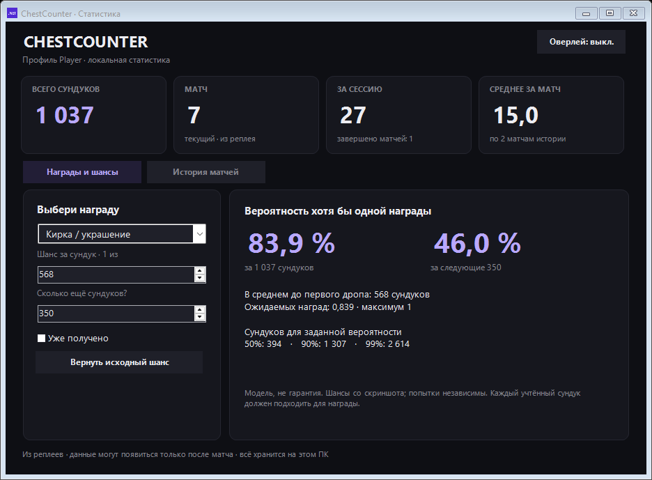
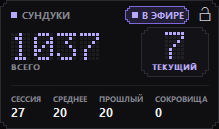

# ChestCounter — счётчик сундуков Fortnite

Локальный счётчик сундуков по реплеям Fortnite: оригинальный оверлей поверх игры, история матчей и калькулятор вероятности дропа. Для Windows 10/11. Форк [xdoofy92/ChestCounter](https://github.com/xdoofy92/ChestCounter).



## Что умеет

- **Оверлей:** общий счёт, текущий или последний матч, сессия, среднее и сокровища. Сохранён оригинальный вид оверлея.
- **Статистика:** история матчей выбранного профиля, счёт за сессию, среднее по завершённым матчам и HTML-отчёт.
- **Стартовый счёт:** можно добавить сундуки, открытые до установки. Он учитывается в общем количестве, но не влияет на среднее и историю.
- **Дроп:** готовые редактируемые шансы для наград, вероятность хотя бы одного выпадения, ожидание и пороги 50%, 90% и 99%.
- **Полученные награды:** одноразовые предметы можно отметить вручную для каждого профиля. Гизмы считаются повторяемыми. Автоматического еженедельного сброса отметок нет.
- **Локальные данные:** история и настройки хранятся на компьютере. Телеметрия и автообновление не добавлены.



## Как это работает

Fortnite записывает файлы повторов в `%LOCALAPPDATA%\FortniteGame\Saved\Demos`. Программа читает эти файлы и определяет открытые сундуки. Включите запись повторов в настройках Fortnite: **Игра → Повторы**.

Во время матча реплей может быть ещё недоступен для чтения. В таком случае оверлей показывает «…», а результат появляется после окончания матча. Чтение реплея и игровой счётчик в этом форке сохранены; в память процесса игры программа не внедряется.

Оверлей лучше проверять в оконном режиме без рамки. Реальный матч после последних изменений пока не проверен.

| Клавиши | Действие |
|---|---|
| `Ctrl + Shift + O` | Показать / скрыть оверлей |
| `Ctrl + Shift + L` | Закрепить / открепить оверлей; закреплённый пропускает клики |

## Шансы наград

Значения для обычных матчей предоставлены пользователем и **не проверяются автоматически**. Их можно менять в окне статистики.

| Награда | Шанс за сундук | Повторяемость |
|---|---:|---|
| Weekly Gold Outfit | 1 / 1 562 500 | Один раз |
| Pirate Shop Access | 1 / 137 500 | Один раз |
| Weekly Vehicle and Decal | 1 / 7 813 | Один раз |
| Weekly Pickaxe or Back Bling | 1 / 568 | Один раз |
| Weekly Jam Track | 1 / 391 | Один раз |
| Weekly Loading Screen | 1 / 272 | Один раз |
| Any Gizmo | 1 / 127 | Повторяемый |

Калькулятор предполагает независимые попытки с постоянной вероятностью и отсутствие скрытой гарантии. Он также предполагает, что каждый учтённый сундук подходил для выбранной награды. Шанс хотя бы одного выпадения за `k` сундуков равен `1 − (1 − p)^k`. Среднее число попыток до первого выпадения — `1/p`; это **не гарантия** получить предмет за такое число сундуков. Для одноразовой награды ожидаемое количество ограничено единицей.

## Сборка самостоятельно

1. Установите **[.NET 10 SDK для Windows x64](https://dotnet.microsoft.com/download/dotnet/10.0)**. Нужен именно SDK, а не только Runtime.
2. Скачайте исходники целиком или клонируйте репозиторий:
   ```powershell
   git clone https://github.com/flexeykinDev/ChestCounter.git
   cd ChestCounter
   ```
3. Запустите `build.bat`. При первой сборке .NET загрузит нужные пакеты.
4. Готовый самостоятельный файл появится в **`dist\ChestCounter.exe`**. Его можно скопировать на другой Windows x64 ПК без установки .NET.

Либо соберите в PowerShell вручную:

```powershell
dotnet publish src/ChestCounter/ChestCounter.csproj -c Release -r win-x64 --self-contained true -p:PublishSingleFile=true -p:IncludeNativeLibrariesForSelfExtract=true -p:EnableCompressionInSingleFile=true -p:DebugType=none -o dist
```

Создание релиза на GitHub — отдельное действие: после сборки можно прикрепить `dist\ChestCounter.exe` к новому Release. Само обновление исходников не заменяет файлы в старых релизах.

## Запуск и данные

Запустите `ChestCounter.exe`, проверьте путь к реплеям в настройках и откройте **«Статистика»**. Вкладка «Награды и шансы» содержит калькулятор, а «История матчей» — таблицу и стартовое значение. Оверлей можно включить кнопкой в программе или горячей клавишей.

Данные сохраняются в `%APPDATA%\ChestCounter`: `data.json` — история, `config.json` — настройки, стартовый счёт, шансы и отметки наград. Чтобы перенести историю на другой компьютер, скопируйте эту папку при закрытой программе.

## Приватность и сеть

Программа хранит статистику локально, не содержит добавленной телеметрии или автообновления. Необязательная страница OBS выключена по умолчанию; при включении слушает только `127.0.0.1`. Программа не требует входа в Epic Games. Скачивание SDK и пакетов во время сборки требует доступа в интернет.

Предыдущий README с подробным аудитом старого состояния форка сохранён в [README.previous.md](README.previous.md). Его ссылки на зафиксированный коммит относятся именно к тому коммиту, а не автоматически ко всем последующим изменениям.

## Проверка

```powershell
dotnet run --project tests/ChestCounter.Checks -c Release -p:OfflineBuild=true -- .\check-output
```

Проверки используют искусственные данные и сохраняют превью в указанную папку. Проверяются формулы, профили, стартовый счёт, история, настройки и отрисовка оверлея. Результат на реальных реплеях зависит от работы записи и формата Fortnite.

## Лицензия и благодарности

[MIT](LICENSE). Основано на [xdoofy92/ChestCounter](https://github.com/xdoofy92/ChestCounter); сведения о библиотеке реплеев и её изменениях — в [lib/PATCHES.md](lib/PATCHES.md).
